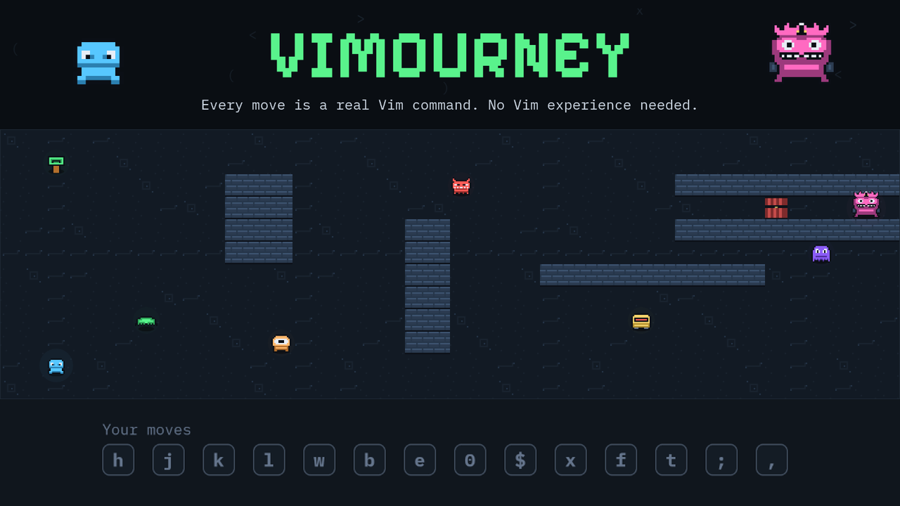
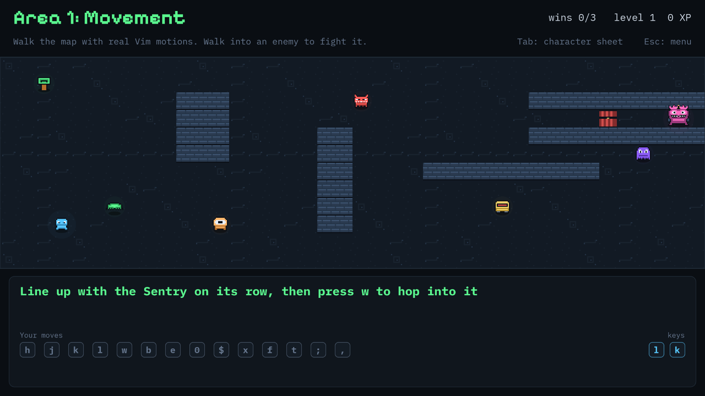
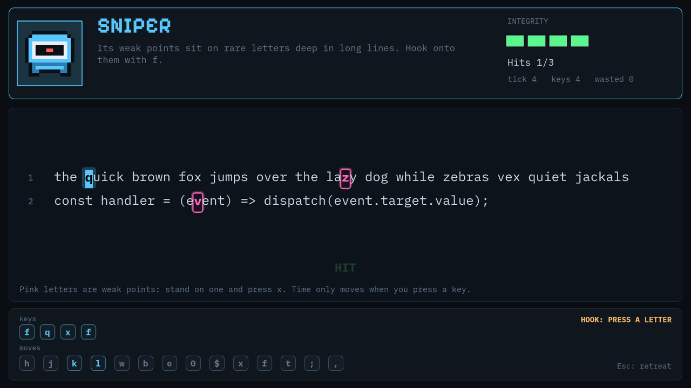
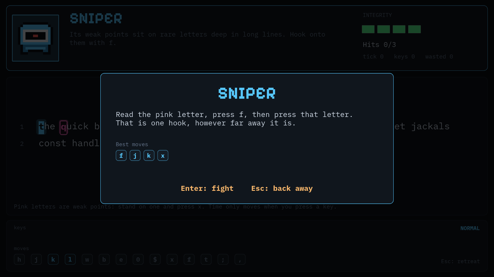
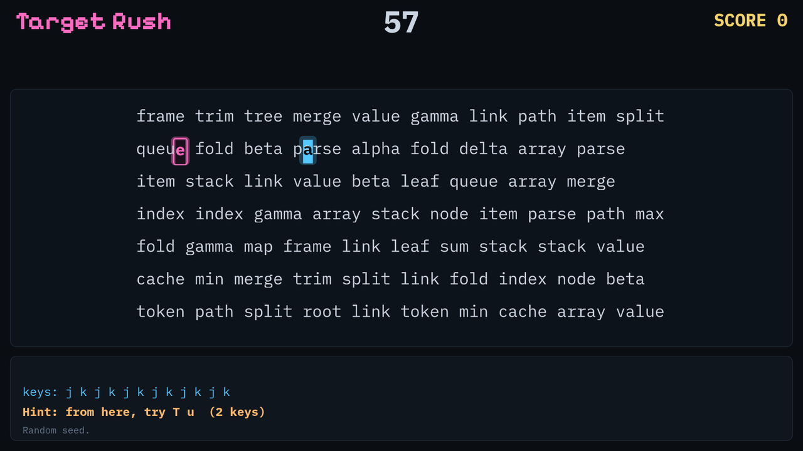

# Vimourney



**A top-down action RPG where every move is a real Vim command.** You walk the map with `h j k l`, hop between landmarks with `w`, hook onto letters with `f`, and beat bosses with nothing but your keyboard. No Vim experience needed: the game teaches each move as you need it.

This repository holds the playable demo and its source. A live link will be added here once the demo is deployed. The game runs in a desktop browser and needs a physical keyboard.

## Screenshots

| The overworld | The Buffer |
| --- | --- |
|  |  |

| Enemy cards | Target Rush |
| --- | --- |
|  |  |

## What's in the demo

- **Two areas.** Area 1 teaches movement (`h j k l w b e 0 $`). Area 2 teaches find and jump (`f F t T ; ,`), and its enemies still ask for what you already learned.
- **Seven enemies and two bosses.** Each one tests a specific set of moves, and a card explains it the first time you meet it. The Warden and the Seeker are the exams at the end of each area.
- **The Buffer.** Fights happen in their own screen, inside lines of text. Time only moves when you press a key, so reading the warning beats reacting fast.
- **Target Rush.** A 60-second arcade game with a local top ten and a daily seed. Fewer keys means more points.
- **Mastery.** Every command is a skill on your character sheet, and it only rises when you use it well.

## How to play

| Keys | What they do |
| --- | --- |
| `h` `j` `k` `l` | Step left, down, up, right |
| `w` `b` `e` | Hop to the next word, the previous word, the end of a word |
| `0` `$` | Run to the start or end of the line |
| `f` + letter | Hook forward onto a letter (`F` goes backward) |
| `t` + letter | Stop just short of a letter (`T` goes backward) |
| `;` `,` | Repeat the last hook, forward or backward |
| `x` | Strike the weak point under your cursor |
| `Tab` | Open the character sheet |
| `Esc` | Back out |

## Run it locally

You need a recent version of [Node.js](https://nodejs.org).

```bash
npm install
npm run game
```

Then open http://localhost:5174.

To run the tests:

```bash
npm test
```

The Vim engine tests compare the emulator with real Vim, so they need `vim` installed.

## How it works

- **Real Vim behavior.** The game runs on a Vim emulator written for this project and checked against real Vim with randomized tests. Nothing about the moves is faked.
- **The map is text.** Each area is a text buffer, and the engine moves you through it. That's why `w` hops between landmarks and `f` hooks onto them.
- **Game rules without the graphics.** Battles, routes, mastery and scoring are plain TypeScript with unit tests, including a bot that proves every fight can be won. The Phaser scenes only draw and handle input.
- **Sprites as code.** Every sprite is drawn by an Aseprite script, so the art can be rebuilt with `game/art/build.sh`.

## Project layout

| Folder | What's inside |
| --- | --- |
| `game/` | The game: Phaser 4, TypeScript and Vite |
| `demo/` | The finished web build, ready to host |
| `vim/` | The Vim emulator and its tests against real Vim |
| `shared/` | Code shared between the apps: keys, audio, saves |
| `app/` | An earlier course-style trainer built with Svelte |
| `docs/` | Design notes, plans and README images |
| `playtest-logs/` | Logs from playtest sessions |

## Deploy your own

The `demo/` folder is a static site. On [Vercel](https://vercel.com/new), import this repository, set **Root Directory** to `demo` and deploy. There's nothing else to configure. After changing the game, rebuild the folder with `npm run demo:build`.

## What's next

Later areas will add bigger jumps, text objects and then operators. The long-term plan is to give other keyboard-driven editors, such as Emacs and Neovim, the same treatment.

## Credits

- Built with [Phaser](https://phaser.io) (MIT license).
- Fonts: [IBM Plex Mono](https://github.com/IBM/plex) and [Pixelify Sans](https://github.com/eiysgoks/pixelify-sans), both under the SIL Open Font License 1.1.
- Sprites made with [Aseprite](https://www.aseprite.org).
